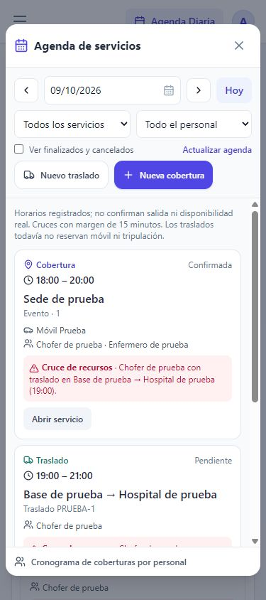

# Entrega 2 — Agenda común de servicios

Fecha: 9 de octubre de 2026. Continúa la estabilización publicada en `7586055`.

## Resultado utilizable

- El tablero muestra **Servicios de hoy**, con traslados y coberturas en una misma lista. Permite abrir el registro original y ver la agenda completa.
- Agenda Diaria abre **Agenda de servicios**: fecha anterior/siguiente/hoy, filtros de tipo y personal, inclusión opcional de finalizados/cancelados, actualización y creación con la fecha seleccionada.
- Los servicios sin horario permanecen visibles. Las tareas que continúan después de medianoche aparecen en ambos días; un cierre exactamente a medianoche no ocupa el día siguiente.
- Se advierten cruces de personas entre coberturas y traslados, entre dos traslados y entre distintos roles. Entre coberturas también se comparan los móviles. El margen existente de 15 minutos se mantiene.
- Un cruce con horas incompletas se presenta como **posible**, para revisión. La interfaz nunca da por libre un vehículo por falta de datos.
- El cronograma anterior de coberturas por personal sigue accesible; sus enlaces manuales no representan integración con WhatsApp Business.
- La vista no agrega datos clínicos a las tarjetas. La ficha original conserva sus datos y permisos actuales.

## Arquitectura y límites

`src/utils/agenda.ts` crea una proyección de lectura de `matches` y `transfers`, con claves diferentes por tipo. No crea una tabla `services`, ni duplica o migra registros históricos. Las altas/ediciones siguen usando sus formularios y tablas originales.

Los traslados actuales carecen de ID de móvil, enfermero y reserva planificada. Sus horas son puntos de control, no nuevas confirmaciones de salida o disponibilidad. Se utiliza el primer punto disponible empezando por salida de base; llegada a base se usa como fin cuando existe. Si el fin es anterior al inicio, se interpreta el cambio de día. Registros de más de un día o con horas mal ordenadas necesitan fechas completas y revisión; este formato heredado no permite resolverlos con certeza.

Por tanto, **no se implementaron aún reservas completas de traslados ni validación transaccional de conflictos en el servidor**. Los avisos no bloquean guardados, no liberan recursos ni asignan automáticamente personal. Un traslado sin móvil no participa en el control de cruces de móviles. Un traslado pendiente sin regreso exige verificación aunque no tenga un aviso de cruce.

Tampoco se implementaron cotizaciones, costos por servicio, prefacturación, cuenta corriente, GPS, Cloud API ni ARCA. Esta entrega es el primer paso visible de la agenda común; no equivale a toda la Fase 1 del plan maestro.

La proyección usa los datos ya cargados por la app y permite actualizarlos manualmente. No incorpora Realtime ni resuelve concurrencia entre operadores. El cálculo de cruces compara registros cargados; la siguiente etapa deberá implementar ventanas de consulta y reservas autorizadas en servidor.

## Verificación

- Tipos, compilación y **21 pruebas**: las 14 existentes más siete casos de agenda.
- Casos nuevos: IDs iguales entre tablas, personal compartido entre tipos/roles, margen exacto de 15 minutos, cruce de medianoche, horas incompletas, traslados simultáneos, exclusión de cerrados, límites de día/año y títulos sin datos de paciente.
- Prueba de interfaz con servidor aislado y datos ficticios (`node tests/ui/server.mjs`, ruta `/tests/ui/harness.html?agenda=1`): ambos tipos visibles, filtros por chofer/tipo, apertura del traslado correspondiente, finalizados opcionales, día siguiente vacío, creación que conserva la fecha, cronograma anterior y cierre con Escape.
- Vista de 390 × 844: el diálogo no presenta desbordamiento horizontal. El selector de fecha usa la presentación propia de la app. No se verificó Safari en un dispositivo físico.
- No se crearon registros reales durante las pruebas.

## Próximas entregas

1. Traslado con móvil/tripulación y ventana planificada explícita; reservas en servidor y migración compatible del histórico.
2. Parte de cierre, revisión administrativa y precio manual por servicio; luego cotizaciones versionadas y costos.
3. Prefacturación/cobranzas. Integraciones únicamente después de confirmar proveedor GPS, configuración de Meta y situación fiscal con contador.

Se mantiene el principio del plan maestro: construir alrededor del servicio compartido y entregar incrementos útiles sin convertir ideas pendientes en funcionalidades confirmadas.

## Reversión

Esta entrega no requiere migraciones de base de datos. Puede revertirse publicando el commit anterior de la aplicación; los registros originales permanecen en sus tablas.
