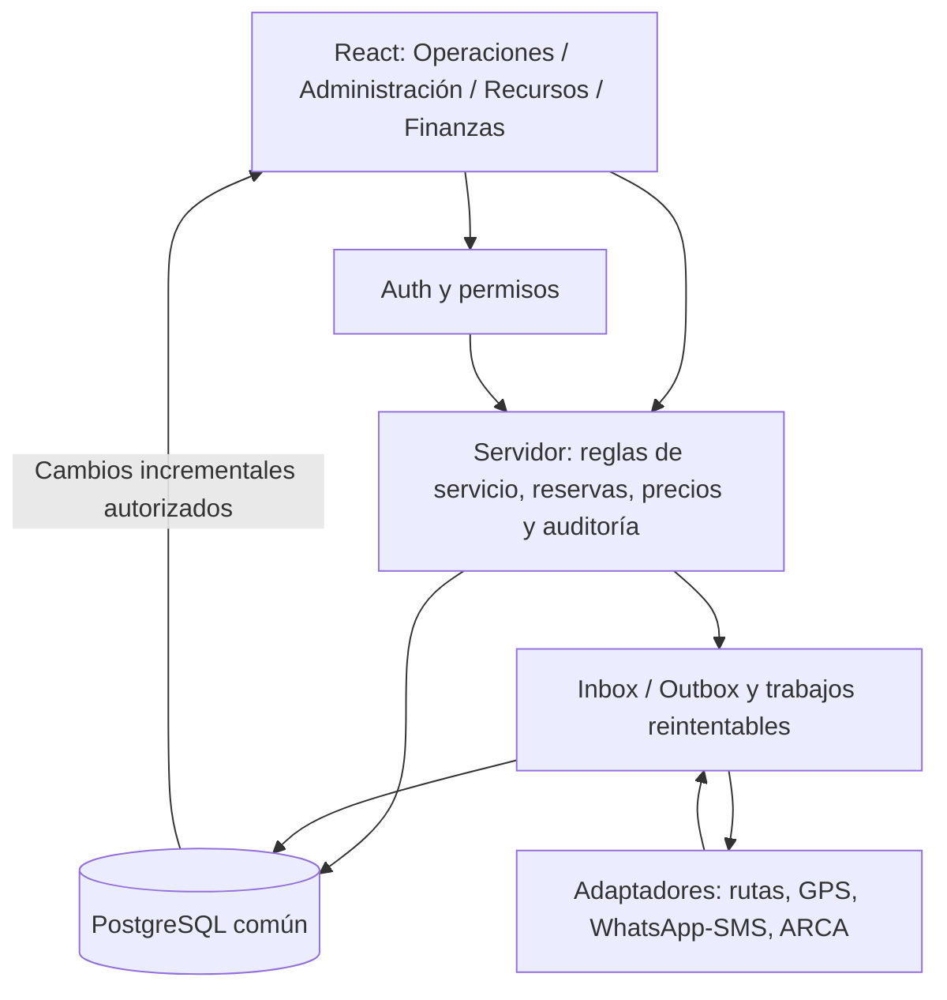
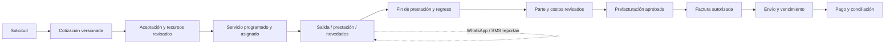

# PLAN MAESTRO — MODELO DISPATCH

**Ambulancias Modelo · Auditoría y propuesta de evolución · 9 de octubre de 2026**

**Alcance:** investigación, diagnóstico y planificación. No se implementaron funcionalidades, no se modificó código productivo ni se alteraron datos, permisos o servicios externos. Todos los ejemplos de operaciones, importes y volúmenes son ficticios. Este documento, su [anexo de integraciones](<C:/Users/USUARIO/Desktop/Nuevo Modelo Dispatch/docs/auditoria/2026-10-09-integraciones.md>) y el [registro de verificación local](<C:/Users/USUARIO/Desktop/Nuevo Modelo Dispatch/docs/auditoria/2026-10-09-verificacion.md>) constituyen el entregable.

**Base examinada:** checkout local en `C:\Users\USUARIO\Desktop\Nuevo Modelo Dispatch`, rama `main`, commit `affb472`. Se inspeccionaron componentes, tipos, servicios, configuración, dependencias, migraciones y pruebas. Las referencias de líneas corresponden a esta versión; los nombres de archivos permiten reencontrarlas si cambia el código.

**Convención de evidencia:** **VERIFICADA — código** significa que el comportamiento está presente en la implementación, no que se haya probado su funcionamiento completo. **VERIFICADA — prueba** identifica ejecución local con datos ficticios. **VERIFICADA — documentación** indica una fuente oficial consultada. **PROBABLE** es una conclusión razonable pendiente de prueba. **CONDICIONADA** depende de información, autorización o proveedor. **NO VERIFICADA** carece de evidencia suficiente. Las propuestas de arquitectura son recomendaciones, no funcionalidades actuales.

## 1. Resumen ejecutivo

Modelo Dispatch tiene una base aprovechable para organizar coberturas, registrar traslados y administrar recursos. La interfaz, el catálogo de personal y móviles, los incidentes, las cargas de combustible y las estadísticas descriptivas evitan comenzar desde cero. **VERIFICADA — código.**

La brecha principal es estructural: coberturas y traslados tienen modelos diferentes y no participan de  una única reserva de ambulancias y personal. No existe un circuito comercial que conecte presupuesto, ejecución, costos, comprobantes y pagos. La flota muestra ocupación estimada por horarios de coberturas; no obtiene posiciones GPS ni estados confirmados por tripulación. **VERIFICADA — código.**

Antes de agregar integraciones deben corregirse defectos que afectan coordinación y conservación de datos: conflictos que cruzan medianoche o cambian el rol de una persona, guardados de cobertura que envían incidentes y avisos como vacíos, y auditorías separadas de la operación que deberían acreditar. Se reprodujeron los primeros casos y el contenido del payload de guardado mediante ejecución aislada, sin base real. **VERIFICADA — prueba local.**

**Recomendación general:** evolucionar hacia un monolito modular con una entidad central `service`, una base PostgreSQL común y funciones de servidor para operaciones críticas e integraciones. Conservar React, Vite, Supabase y los flujos útiles; extraer responsabilidades de `App.tsx` por entregas pequeñas. No se justifica hoy reconstruir todo, incorporar microservicios ni reemplazar la aplicación por un ERP completo. **PROBABLE — decisión de diseño.**

El primer resultado empresarial debe ser una agenda confiable de **todos** los servicios, con recursos realmente asignados, conflictos consistentes y una bandeja de servicios terminados pendientes de revisión/facturación. Después, costos y cotizaciones versionadas; finalmente, WhatsApp, GPS y emisión fiscal según disponibilidad externa.

**Límites de esta auditoría:** se completaron pruebas locales, pero no una certificación de operación productiva. En la comprobación del sitio de Vercel la interfaz quedó en carga y no se obtuvo un inventario autenticado. No se verificaron cantidades actuales de vehículos/personal, esquema efectivo, políticas RLS, backups, plan contratado ni versión desplegada. No había una sesión de Supabase identificada en las pestañas disponibles. Los seis vehículos y diez integrantes del pedido se mantienen como referencia histórica, nunca como conteo confirmado. Tampoco se conoce proveedor GPS, régimen fiscal o elegibilidad del número de WhatsApp.

## 2. Radiografía del sistema actual

### 2.1 Arquitectura, infraestructura y dependencias

Índice de evidencia local: [aplicación y caminos activos](<C:/Users/USUARIO/Desktop/Nuevo Modelo Dispatch/App.tsx:247>), [modelos](<C:/Users/USUARIO/Desktop/Nuevo Modelo Dispatch/src/types.ts>), [guardado y conflictos](<C:/Users/USUARIO/Desktop/Nuevo Modelo Dispatch/src/services/matches.ts:83>), [modal de cobertura](<C:/Users/USUARIO/Desktop/Nuevo Modelo Dispatch/src/components/modals/MatchModal.tsx:45>), [flota](<C:/Users/USUARIO/Desktop/Nuevo Modelo Dispatch/src/components/FleetStatusWidget.tsx:21>), [traslado](<C:/Users/USUARIO/Desktop/Nuevo Modelo Dispatch/src/components/modals/TransferModal.tsx>), [combustible y compras](<C:/Users/USUARIO/Desktop/Nuevo Modelo Dispatch/src/components/modals/FuelBatchModal.tsx>), [membresía/RLS](<C:/Users/USUARIO/Desktop/Nuevo Modelo Dispatch/supabase/migrations/202609240001_dispatch_access.sql>), [pruebas locales](<C:/Users/USUARIO/Desktop/Nuevo Modelo Dispatch/tests/operations.test.mjs>), [pruebas de acceso SQL](<C:/Users/USUARIO/Desktop/Nuevo Modelo Dispatch/supabase/tests/access.sql>), [configuración de hosting](<C:/Users/USUARIO/Desktop/Nuevo Modelo Dispatch/vercel.json>) y [dependencias](<C:/Users/USUARIO/Desktop/Nuevo Modelo Dispatch/package.json>).

| Área | Evidencia actual | Evaluación |
|---|---|---|
| Frontend | React 19, TypeScript 5.8, Vite 6, Tailwind 3, Lucide; `package.json` y lockfile | VERIFICADA — código. Stack adecuado para esta escala |
| Composición | `App.tsx` concentra estado, cargas, pantallas, mapeos, decisiones y varios modales; existen `src/components`, `src/services`, `src/utils` | Modularización parcial; alta posibilidad de divergencias |
| Backend | Cliente `src/lib/supabase.ts`; llamadas directas a tablas mediante Supabase JS | API REST de datos; no se encontró backend propio de integraciones/webhooks en el checkout |
| Carga de datos | `App.tsx:520`, siete consultas paralelas, `select('*')`, coberturas con `audit_logs(*)` | Recarga global, sin paginación ni ventana de agenda; crecimiento problemático |
| Autenticación | Login activo dentro de `App.tsx:304`, sesión y suscripción de Auth | Supabase Auth observado; funcionamiento productivo actual NO VERIFICADO |
| Autorización | Migración `202609240001_dispatch_access.sql`, membresía privada y guardas RLS | Control de operador previsto; no equivale a roles finos ni demuestra despliegue |
| Hosting | `vercel.json`, dominio conocido de Vercel; `vite.config.ts` | Configuración local verificada; plan, logs y despliegue actual NO VERIFICADOS |
| Seguridad frontend | CSP, HSTS, nosniff, protección de marcos, URLs validadas, CSV escapado, sourcemaps desactivados | Controles útiles, insuficientes para proteger datos sin autorización en servidor |
| Error de carga | Conserva estado anterior y muestra error en `loadData` | Conservar trabajo es positivo; falta bloquear decisiones basadas en datos vencidos y distinguir guardado de refresco |
| Actualización multioperador | No se observó suscripción Realtime a los datos ni control de versión en guardados | Riesgo de sobrescritura y decisiones con agenda antigua |
| Notificaciones | Enlaces `wa.me`, copiar agenda y flags `driverNotified`/`nurseNotified` | Envío manual; sin Cloud API, webhook ni evidencia de entrega |
| Pruebas | `tests/operations.test.mjs`, `supabase/tests/access.sql` | Cinco pruebas locales pequeñas; SQL de acceso disponible, no ejecutado hoy |
| Esquema reproducible | Tres migraciones incrementales; no se encontró migración base completa | Un entorno nuevo no puede reconstruirse de forma demostrada sólo con esos archivos |

La dependencia Supabase está declarada como `"2"`; el lockfile limita la instalación reproducible, pero las actualizaciones deben revisarse y probarse. No se encontraron workflows de CI en el inventario del checkout. La automatización de despliegue real no fue auditada.

Supabase permite acceso desde navegador con RLS. Su cliente devuelve por defecto hasta 1.000 filas, aunque ese límite puede configurarse: una consulta sin paginación no garantiza traer todo el historial. La configuración real de la cuenta es desconocida. [API oficial](https://supabase.com/docs/guides/api), [consulta y límites](https://supabase.com/docs/reference/javascript/select).

### 2.2 Modelos observados

| Modelo | Información representada | Brecha para el circuito integral |
|---|---|---|
| `matches` | Fecha, hora, duración/extensión, tipo, chukkers, sede/cancha, cliente, móvil, chofer, enfermero, tercer integrante, estado, avisos, incidentes | Sin servicio común, salida/regreso confirmados, reservas transversales o vínculo comercial |
| `transfers` | Fecha, chofer, paciente, origen/destino, tipo de ambulancia, horas de control, km, espera, importe a facturar, estado | Falta asignación de ambulancia concreta, enfermero y cliente mediante relaciones; horas sin fecha completa |
| `ambulances` | Número, tipo y campos de mantenimiento/documentación/kilometraje | Sin historial normalizado de reparaciones, costo/km, dispositivo GPS o bloqueo temporal integrado |
| `staff` | Identidad, rol único, contacto y condición externa/eventual | Sin turnos, licencias, descansos, habilitaciones múltiples y reservas comunes |
| `fuel_records` | Móvil, fecha, chofer o nombre externo, litros y artículos | Sin importe de compra, comprobante, odómetro ni imputación económica al servicio |
| `clients` | Contactos básicos | Sin perfil fiscal, condiciones comerciales o cuenta corriente |
| `locations` | Lugares y vínculos informativos | Sin coordenadas/acceso operativo normalizados ni geocercas |
| `audit_logs` | Cambios de coberturas | Cobertura parcial; no es historial confiable de todas las entidades y acciones |

Fuente principal: `src/types.ts`, mapeos de `App.tsx`, `src/services/resources.ts`, `src/services/matches.ts` y `src/services/transfers.ts`. Son modelos observados en código, no una inspección del catálogo PostgreSQL vigente.

### 2.3 Inventario funcional y clasificación

**Criterio:** “conservar” refiere al flujo y valor de negocio, sin eximir errores técnicos. “Observada” no acredita CRUD productivo. No se borraron ni modificaron funcionalidades.

| Funcionalidad | Estado actual | Problema | Mejora posible | Prioridad |
|---|---|---|---|---|
| Tablero compacto y acciones naturales | Conservar; observado, `App.tsx:1612` | Información operacional incompleta para traslados | Agenda unificada; atención antes de estadísticas | Alta |
| Actividad del período | Conservar; cálculo básico probado, `OperationsInsights.tsx`, pruebas | No mide facturación, margen o deuda | Mantener después de operación; añadir métricas sólo con datos económicos |
| Agenda diaria/copiar parte | Observada, `App.tsx:1066` | Incluye coberturas, no toda la operación | Incorporar traslados y estados reales | Alta |
| Crear/editar cobertura | Observada con defectos de guardado, `MatchModal.tsx:45`, `matches.ts:168` | Campos omitidos se envían como falsos/vacíos; hooks tras retorno condicional | Actualización por campos, auditoría atómica y revisar apertura/cierre | Crítica |
| Detección de conflictos | Error reproducido, `App.tsx:247`, `matches.ts:83` | Medianoche, roles cruzados, reglas compartidas y sólo coberturas | Motor único en servidor con intervalos completos | Crítica |
| Carga rápida de coberturas | Observada, `QuickAddModal.tsx` y `App.tsx:862` | Duración de 90 min y algoritmo diferente; sin reserva común | Plantillas por tipo y validación común | Alta |
| Suspender/extender/reprogramar | Observada parcialmente | Falta impacto automático sobre recursos, costos y comunicaciones | Historial de cambios; propuesta de recotización/reasignación | Alta |
| Incidentes de cobertura | Observada; riesgo de pérdida probado en payload | Edición general puede vaciar incidente | Registro separado protegido; acceso mínimo | Crítica |
| Estado de flota | Rediseñar, `FleetStatusWidget.tsx:21` | Sólo horarios de coberturas; día UTC; no excluye Completed; etiqueta “En Tiempo Real” | Separar plan, confirmación y señal GPS | Crítica |
| Personal y su historial | Observada, `StaffModal.tsx`, historial | Sin disponibilidad/descanso; edición depende de hover | Acciones visibles en móvil, disponibilidad y reservas | Alta |
| Móviles/mantenimiento | Observada parcialmente, `AmbulanceModal.tsx`, `resources.ts` | Campos last/nextService del tipo no completan circuito persistente; sin órdenes | Vencimientos y bitácora; probar persistencia campo por campo | Alta |
| Clientes/sedes | Conservar catálogo, modales correspondientes | Relaciones por texto, datos fiscales ausentes | Catálogos comunes con identidad estable | Alta |
| Traslados | Incompleta/rediseñar, `TransferModal.tsx`, `App.tsx:2203` | Tabla de 900 px en móvil; sin móvil/enfermero asignados; no participa en conflictos | Formulario por etapas y tarjeta de servicio común | Crítica |
| Combustible y compras | Conservar flujo reciente, `FuelBatchModal.tsx`, `App.tsx:2147` | Acepta externo y cero litros; falta precio/recibo/corrección; orden sin consulta por fecha | Gastos tipificados y carga rápida; no deshacer la mejora móvil | Media |
| Exportación CSV | Núcleo probado, `App.tsx:614`, utilidades | No sustituye exportación completa ni backup | Conservar escape de fórmulas; ampliar reportes según permisos | Media |
| Avisos manuales WhatsApp | Observada, enlaces `wa.me` | Flag manual no demuestra envío/entrega; algunos errores de actualización ignorados | Conservar canal manual y distinguir estados | Alta |
| Auditoría | Incompleta, `matches.ts:230`, modal de auditoría | Insertada antes del guardado, errores no verificados, campos faltantes | Servidor/trigger en transacción y actor explícito | Crítica |
| Login/pertenencia | Observada; migración preparada | Despliegue/políticas no auditados en vivo; operador no es matriz de roles | Validar acceso completo antes de habilitar más personas | Crítica |
| Pantallas/ayudantes duplicados | Ineficiente, inline App frente a componentes/servicios | Reglas y mapeos diferentes; login externo no es el activo | Trazar consumidores, extraer y retirar sólo tras autorización | Media |
| Cotizaciones/cobranzas/ARCA/GPS/API WhatsApp | No encontradas en checkout | Circuito integral inexistente | Construir por fases sobre servicio común | Según fase |

### 2.4 Qué se ejecutó realmente

`npm run typecheck`, `npm test` y `npm run build` terminaron correctamente. Las cinco pruebas cubren utilidades de fechas/períodos, casos vacíos y suspendidos de estadísticas, URLs y escape de CSV. **No** comprueban login, modales, reservas, CRUD, concurrencia, RLS o recuperación de backups.

El build produjo un JS principal de **583,90 kB minificado / 152,12 kB gzip**, con advertencia por superar 500 kB. La compilación exitosa no excluye problemas de hooks o errores de uso. `npm audit --omit=dev` reportó cero vulnerabilidades conocidas en dependencias de producción a la fecha; no se evaluaron con ese comando las de desarrollo ni la seguridad lógica.

Se ejecutaron funciones reales de conflictos con fixtures ficticios en memoria y el guardado con un cliente Supabase simulado: solapamiento nocturno entre días no detectado; persona compartida en roles distintos no detectada; móvil en dos canchas de una sede degradado a aviso compartido; payload de edición sin incidente/avisos envía `false`, `false`, texto vacío y avisos `false`. Eso demuestra comportamiento local, no pérdida documentada de un registro productivo.

## 3. Problemas detectados, por impacto y urgencia

### P0 — Coordinación, conservación de datos y acceso

1. **Reservas incompletas y conflictos incorrectos. VERIFICADA — prueba/código.** Un servicio de 23:30 a 01:30 y otro de 00:15 del día siguiente pueden compartir unidad/persona sin alerta. Se compara persona por puesto, no por identidad en cualquier puesto. Traslados quedan fuera del algoritmo. Corrección conceptual: intervalos `timestamptz`, zona operativa Argentina, reserva de cada recurso, tiempos de preparación/viaje/regreso y comprobación transaccional al guardar.
2. **Incidentes y avisos pueden vaciarse al editar. VERIFICADA — prueba de payload.** El modal no incluye los campos que `saveMatch` convierte en falsos/vacíos. Separar actualización de planificación de incidentes/avisos; no aplicar valores predeterminados a campos no enviados. Revisar registros afectados sólo con autorización posterior, sin presumir que ya hubo daño real.
3. **Estado de flota puede inducir decisiones erróneas. VERIFICADA — código.** Un Completed puede aparecer ocupado por su horario; un traslado no ocupa el móvil; no hay confirmación de regreso, y la fecha UTC difiere de Argentina por la noche. Nunca equiparar fin del horario con disponibilidad física.
4. **Seguridad productiva pendiente de comprobar. NO VERIFICADA.** Las migraciones restringen acceso, pero no se certificó su aplicación. Antes de integrar datos clínicos, fiscales o ubicación: inspeccionar policies/grants efectivos y probar anónimo, autenticado no aprobado, operador, revocado y cada rol. No es una afirmación de exposición actual.
5. **Guardado/auditoría no atómicos. VERIFICADA — código.** El log puede existir aunque falle el cambio, o el cambio sin log. Otros operadores pueden sobrescribir datos. Añadir versión esperada, transacción y actor en servidor.

### P1 — Estabilidad y visibilidad

6. **Hooks tras retorno condicional. VERIFICADA — código, ejecución completa pendiente.** `MatchModal.tsx:21`, `StaffModal.tsx:14` y `ClientModal.tsx:14` retornan antes de hooks, con modales montados desde App. Deben probarse apertura/cierre/edición y corregirse respetando orden estable. No atribuir el spinner productivo a esto sin logs y reproducción.
7. **Datos globales y posiblemente parciales. VERIFICADA — código; truncación productiva CONDICIONADA.** Carga de todo el historial y auditorías, sin paginación. Una falla de tabla aborta la actualización del conjunto. Ventanas temporales, consultas mínimas, estado de sincronización por módulo y detalles bajo demanda.
8. **Errores de avisos masivos no tratados. VERIFICADA — código.** No basta `await` si Supabase devuelve un objeto con `error`. Mostrar resultados por fila y conservar pendientes. Marcar notificado tampoco acredita envío.
9. **Horarios/ubicaciones poco normalizados. VERIFICADA — código.** Tipo personalizado empaquetado dentro del texto de lugar; seis horarios de traslado sin fecha; duraciones por defecto rígidas. Migrar sin interpretar silenciosamente datos ambiguos.
10. **Entorno no reproducible y continuidad desconocida. VERIFICADA — repositorio / NO VERIFICADA — operación.** No hay baseline completo; migración de membresía presupone un único usuario previamente autenticado. Faltan restore probado, responsables y objetivos de recuperación.

### P2 — Productividad y crecimiento

11. Tabla de traslados ancha, edición de personal poco visible en touch y fechas nativas inconsistentes con preferencia iOS. Conservar tarjetas y formularios verticales; realizar prueba real móvil.
12. Mapeos y reglas duplicados entre App y servicios; algunos componentes externos no son el camino activo. La limpieza se decide por consumidores y pruebas, sin eliminar a ciegas.
13. `Cache-Control: no-store` para todo en `vercel.json` reduce reutilización de assets públicos. Revisar caché de archivos versionados; datos autenticados conservan controles apropiados. El bundle grande y recarga global perjudican conexiones débiles.
14. Gastos sin importes, servicios sin vínculo fiscal y mantenimiento sin historia económica impiden calcular margen real. Ningún gráfico soluciona la falta de esos registros.

## 4. Arquitectura futura recomendada

### 4.1 Módulos que aportan valor

| Agrupación recomendada | Incluye | Decisión |
|---|---|---|
| Operaciones | Dispatch, traslados, coberturas, calendario, incidentes, partes | Prioritario; pantallas específicas sobre servicio común |
| Comercial y administración | Clientes, tarifas/costos, cotizaciones, revisión y prefacturación | Prioritario después de estabilización |
| Recursos | Flota/mantenimiento y personal/disponibilidad | Catálogos compartidos; funcionalidades graduales |
| Finanzas | Cuentas corrientes, pagos, facturas y adaptador fiscal | Cobranzas simples antes de ARCA |
| Comunicaciones y seguimiento | WhatsApp/SMS/GPS/mapas | Adaptadores opcionales, no sistemas con agendas propias |
| Reportes y configuración | Métricas, roles, parámetros, auditoría, integraciones | Transversal; evitar otra carga administrativa |

No crear doce aplicaciones, doce bases o catálogos duplicados. Postergar multiempresa, portal de clientes, contabilidad general, nómina legal, compras complejas, inventario hospitalario y optimización automática de rutas hasta demostrar necesidad.

**PROBABLE — diseño:** usar funciones PostgreSQL transaccionales para reservas/cambios y Supabase Edge Functions o un único backend pequeño para secretos/webhooks/jobs. Elegir un runtime antes de implementar según SOAP/criptografía ARCA y necesidad de conexiones persistentes GPS. No mantener simultáneamente varios backends por comodidad. Una API del GPS por polling/webhook evita exigir WebSocket persistente en funciones efímeras; si el protocolo requiere listener TCP, alojarlo aparte o delegarlo al proveedor.

### 4.2 Registro común de servicio

Propuesta `services`: UUID interno, número humano único, tipo traslado/cobertura, cliente, sede/base, inicio/fin previstos, zona horaria, estado operacional, estado de revisión, versión y referencias históricas. El número humano no sirve como autorización ni token de acceso.

Relaciones propuestas:

| Entidad | Propósito/regla |
|---|---|
| `transfer_details`, `coverage_details` | Detalles específicos 1:1; no repetir cliente ni estados comunes |
| `service_assignments` | Recursos por rol, intervalo y vigencia; cambio de móvil conserva historia |
| `resource_reservations` | Ocupación común de vehículo/persona; bloqueos por mantenimiento/licencia |
| `service_events` | Evento, actor, canal, hora reportada/ocurrida/recibida, versión, motivo, idempotencia |
| `service_parts` | Horas/km reales, extras, incidente y revisión; clínica separada y restringida |
| `quotes`, `quote_versions`, `quote_lines` | Cotización y snapshots inmutables del precio/costo; aceptación de una versión |
| `rate_versions`, `cost_versions` | Valores vigentes desde una fecha; autor/aprobación |
| `service_costs` | Gasto real o asignación justificada; fuente y método para no duplicar combustible |
| `billing_items`, `invoice_lines` | Trabajo facturable e imputación; puede repartirse o agruparse sin doble facturación |
| `payments`, `payment_allocations` | Cobros y aplicación parcial a comprobantes; movimientos compensatorios |
| `vehicle_positions`, `device_bindings` | Posición e identidad técnica del equipo; estado operacional separado |
| `message_inbox`, `message_outbox` | Recepción/envío durable, ID externo, entrega, contexto y reintentos |

Estados operacionales propuestos: `borrador → programado → asignado → salida → en_servicio → finalizado → regreso → disponible/cerrado_operativo`. Algunas coberturas locales pueden omitir etapas, mediante reglas por tipo aprobadas. Reprogramado es un evento; suspendido/cancelado requieren motivo y resolución económica. Incidente es un evento/alerta, no un estado que borre el resto.

Estado de vehículo y estado del servicio no tienen una correspondencia 1:1: la unidad puede terminar un servicio y seguir retornando o en limpieza. “Sin señal GPS” es salud de la fuente de ubicación, compatible con cualquier estado operacional. La revisión administrativa, facturación y pago son dimensiones independientes.

### 4.3 Reglas de integridad y migración

Reservas se validan contra **todos** los servicios, mantenimiento y disponibilidad. Intervalos de ocupación incluyen preparación, viaje, prestación y retorno estimados, con márgenes configurables. Comparar identificadores de personas aunque cambie su puesto. Una misma persona no cubre dos puestos de un servicio salvo regla legal/operativa expresamente validada. No inventar descansos obligatorios: requiere convenio, contratos y asesoramiento laboral.

La opción de compartir móvil entre canchas requiere habilitación operacional específica, capacidad de respuesta y aprobación con motivo; ubicación coincidente no alcanza. Revalidar en servidor dentro de una transacción para evitar dos operadores asignando el mismo recurso al mismo tiempo. La UI propone alternativas y el operador confirma.

Migración progresiva: esquema aditivo; tabla de correspondencia única `source_type/source_id → service_id`; importación repetible; conciliación de conteos/relaciones; vista compatible para pantallas antiguas; un único camino de escritura por fase. No hacer dual-write desde navegador. Registros con horas ambiguas o tipo empaquetado pasan a una cola de revisión. Conservar identificadores y evidencia original; no convertir datos clínicos en payloads de comunicaciones.

## 5. Análisis funcional de los módulos

### 5.1 Operaciones, calendario y coberturas

La pantalla inicial debe responder “hoy”, “próximos”, “en curso”, “demorados” y “requieren atención”. En celular: lista temporal compacta, acciones dentro de cada servicio, detalle expandible, sin FAB ni contadores históricos en encabezados operativos. Estadísticas en su sección o debajo de la operación. La agenda por recursos puede ser horizontal en escritorio; en móvil debe existir una alternativa de lista que no requiera desplazarse lateralmente para actuar.

Ejemplo ficticio: `Servicio 184 · Cobertura · Club ejemplo · Cancha 2 · 14:00–16:00 · Móvil 3 · chofer + enfermero`. Debajo: preparación/salida prevista, confirmación, extensión y próximo compromiso. Si se demora hasta 16:30, recalcular conflictos y extras; no enviar cambios ni emitir cargos sin la revisión indicada por contrato.

Agrupar torneo/contrato → fechas → coberturas por cancha, con recursos reservados individualmente. Duración sugerida por deporte configurable, chukkers informativos, margen y tiempo real. No inferir duración exacta sólo de chukkers. Suspensión climática permite reprogramar conservando el servicio o crear una nueva ocurrencia relacionada cuando corresponde; registrar aviso, condición de cobro y motivo. Varias unidades de un evento son asignaciones/capacidades explícitas.

Carga rápida mediante cliente/sede/plantilla habituales y repetición revisable. Alertas concretas: falta tripulación, recurso bloqueado, salida vencida, extensión que pisa siguiente servicio. Cada alerta tiene responsable, vencimiento y reconocimiento, evitando una lista infinita de avisos sin resolución.

### 5.2 Traslados y parte de servicio

Dos etapas: **programar** (cliente, origen/destino, fecha/hora, tipo requerido, unidad concreta, tripulación, requerimientos mínimos) y **cerrar parte** (horas reales completas, km, espera, extras, incidencias). Información sanitaria mínima separada por permisos. No obligar a completar el parte al recibir una solicitud.

Registrar origen/destino como lugares con acceso operativo y texto complementario; traslados interprovinciales conservan fecha y hora completas de cada punto. Requisitos de habilitación provincial/interjurisdiccional y atención sanitaria deben validarse localmente, no deducirse del software. Crear por separado la disponibilidad del vehículo, retorno y preparación siguiente.

### 5.3 Cotizaciones y motor de costos

**Recomendación:** motor propio de reglas sencillo y versionado, proveedor externo sólo para distancia/tiempo. Una calculadora externa genérica difícilmente refleja simultáneamente espera, tripulación, polo y convenios particulares; no se identificó una integración tarifaria existente. **PROBABLE — diseño.**

Traslado: ruta `base → origen → destino → base/otro punto decidido`, separando km con paciente y vacíos. Duración incluye preparación, recorrido, espera y retorno; peajes por tramo y unidad. Insumos: consumo de combustible por unidad/tipo, precio vigente, mantenimiento/desgaste por km, chofer/enfermero por tiempo, nocturnidad/feriados según reglas aprobadas, adicionales y costo fijo de despacho. Evitar sumar combustible dentro de costo/km y otra vez como ítem independiente.

Cobertura: costo de ida/regreso + permanencia de cada unidad + horas de cada profesional + extras y mínimos. Vender por hora/partido/jornada como condiciones comerciales, conservando el costo de los recursos ocupados. Eventos de varios días tienen ocurrencias y reglas de cancelación/extensión; un club puede tener contrato con lista de tarifas vigente.

Fórmula propuesta: `costo previsto = variables + costos fijos imputados + contingencia explícita`; `precio neto sugerido = costo previsto / (1 − margen deseado)`. **Margen no es recargo:** con costo ficticio 100 y margen 25%, precio 133,33; un recargo de 25% da margen 20%. Impuestos y tratamiento fiscal se agregan según contador, no por una suposición de IVA general. Separar rentabilidad operativa de ingreso final con impuestos.

Controles contra pérdidas: costos con fecha de actualización y alarma de vencimiento; piso de contribución; advertencia por costos faltantes; autorización y motivo para descuento bajo piso; estimación de km/espera explícita. No bloquear una urgencia sanitaria por presupuesto incompleto: registrar excepción comercial para revisión posterior.

Costos se mantienen por actualización administrativa verificable, importación simple de precios y costos reales de combustible/personal/taller. No depender de scraping de estaciones. Versionar moneda, fecha, fuente y responsable. Tarifas especiales nunca modifican presupuestos históricos.

Cotización: número, cliente, validez, condiciones, versión, detalle, total, PDF empresarial, costo interno y estado `borrador/enviado/aceptado/rechazado/vencido`. PDF del cliente no expone margen ni datos clínicos innecesarios. Versión enviada queda fija; corrección genera nueva versión. Aceptación convierte una sola vez a servicio mediante clave idempotente y copia del precio acordado. La aceptación comercial no garantiza disponibilidad: revalidar recursos antes de confirmar programación.

Comparar previsto/real por servicio: km, tiempo de personal, combustible consumido estimado, peajes, extras y gastos imputables. Una carga de tanque no se asigna totalmente al viaje que ocurrió ese día. Mostrar método de reparto, cobertura de datos y margen “provisional” mientras falten costos. Gastos indirectos por mes se distribuyen con una regla acordada; no fabricar precisión.

### 5.4 Clientes, prefacturación y cobranzas

Cliente común incluye contactos, razón social/CUIT/domicilio/condición fiscal cuando corresponda, persona solicitante, pagador, convenio, vencimientos y moneda. Paciente y cliente facturado pueden ser distintos. Mantener destinos operativos y domicilios fiscales como datos con fines diferentes.

Parte terminado → revisión humana → ítems facturables → agrupación por cliente/período → aprobación. Cierre mensual de club: seleccionar coberturas, revisar canceladas/extensiones, deducir anticipos según tratamiento contable y bloquear ítems ya incluidos. Factura mensual puede contener varias líneas de servicios, con trazabilidad de cada una. El precio acordado y las correcciones aprobadas forman el importe a facturar.

Cuentas corrientes: comprobantes, vencimientos, pagos, aplicación parcial, saldo y antigüedad de deuda. Registrar medio, fecha, referencia y evidencia con acceso restringido. Conciliación manual/importación revisada antes de integrar bancos. Anticipos, retenciones y notas de crédito requieren criterio contable; no resolverlos restando importes sin registro.

Exportación para contador de comprobantes/cobros/servicios; catálogo y formato se acuerdan con su herramienta. No construir libro mayor, declaraciones impositivas o nómina legal en esta etapa.

### 5.5 Flota, personal y gastos

Vehículos: estado técnico y disponibilidad temporal, odómetro con fecha/fuente, documentación y vencimientos, reglas de service por fecha/km, trabajos/insumos/costo/taller y responsable. Cubiertas, batería y aceite pueden ser categorías en la bitácora; no necesitan un módulo independiente. Avisos accionables y bloqueo sólo según política operacional. GPS puede complementar km si el equipo entrega odómetro adecuado; distancia entre pings no reemplaza automáticamente kilometraje confiable.

Personal: roles/habilitaciones, contactos verificados, fijo/eventual, disponibilidad, licencias y asignaciones. Horas trabajadas se derivan del parte y se revisan para liquidación interna; no asumir convenio ni importar reglas de nómina externa. Sugerir candidatos por disponibilidad, habilitación, descansos y proximidad cuando exista GPS autorizado; el operador decide. Personal no registrado se incorpora con información mínima y aprobación, evitando perder la identidad de quien actuó.

Conservar carga de combustible con “otro/no registrado”, artículos y cero litros para compras no combustibles. Añadir tipo de gasto, importe, comprobante opcional, móvil/servicio cuando aplique y corrección trazable. Ejemplo: franela comprada en estación es gasto de limpieza, no consumo de combustible. Nunca exigir inventar litros para guardar una compra.

### 5.6 Reportes y configuración

Métricas prioritarias: servicios pendientes de revisión/facturar, deuda vencida, presupuestos sin respuesta, conflictos sin resolver, retrasos, margen previsto/real con cobertura de costos, horas/km vacíos y vencimientos próximos. Filtros por período/cliente/unidad/tipo; clic abre registros que explican el total. Evitar contadores acumulados de toda la historia en cada pestaña.

Configuración central: bases, duraciones, buffers, reglas de precio, roles, tipos de eventos, retención y parámetros de integración. Cambios de configuración auditados y con vigencia; no requieren que el usuario edite código.

## 6. Integraciones externas

El [anexo documental](<C:/Users/USUARIO/Desktop/Nuevo Modelo Dispatch/docs/auditoria/2026-10-09-integraciones.md>) contiene alternativas, fuentes oficiales, restricciones y cálculos. Aquí se establecen decisiones de arquitectura y operación.

### 6.1 GPS: integración condicionada al equipo existente

Primero obtener fabricante/modelo/firmware, proveedor/plataforma, titular del contrato, SIM/APN, documentación de API/protocolo, permisos, frecuencia, histórico, límites, costo y posibilidad de exportar/reconfigurar. No solicitar credenciales en el chat ni mover equipos durante investigación.

Orden: **A API del proveedor actual**; **B protocolo compatible autorizado**; **C intermediario de rastreo**; **D sustitución**, sólo si costo/compatibilidad justifican descartar A–C. Traccar tiene lista de equipos, API y WebSocket, pero compatibilidad debe comprobarse con modelo y firmware. [Equipos](https://www.traccar.org/devices/), [API](https://www.traccar.org/traccar-api/).

Adaptador recibe cambios de posición; persiste última posición y un histórico limitado; UI actualiza sólo unidad afectada mediante eventos autorizados. Si hay polling, uno central en servidor con límite/backoff, no un polling por cada navegador. No ejecutar `loadData()` por cada ping.

Mostrar identificación, posición conocida, hora del equipo y recepción, antigüedad, velocidad/movimiento si existen, servicio/unidad/tripulación y destino según permisos. Diferenciar disponible, asignada, en camino, en servicio, regresando, fuera de servicio; señal GPS en indicador separado. Posición antigua no se presenta como viva.

Geocercas de base/hospital/club pueden generar “posible llegada”, con radio, precisión, permanencia mínima y revisión. Vehículo detenido no significa disponible; cruzar una geocerca no acredita atención ni llegada confirmada. Telemetría tardía no debe retroceder la última ubicación.

Para seis equipos **hipotéticos**, 12 h/día durante 30 días a 60 s producen 129.600 puntos; a 30 s, 259.200. Volumen, latencia, retención y costos reales siguen **CONDICIONADOS**. Conservar posiciones detalladas sólo durante el plazo operativo justificado; agregados posteriores si son necesarios. Acceso del chofer a su asignación y operador a flota; clientes no acceden a historial del personal.

### 6.2 WhatsApp y SMS

El pedido actual vuelve a incluir WhatsApp; se investiga como módulo futuro, sin activarlo. **Cloud API oficial** o BSP con API documentada. Evitar automatización de WhatsApp Web no oficial. Número existente, coexistencia, portabilidad, opt-in, tarifa vigente y responsables son condiciones de contratación, no capacidades confirmadas.

Flujo propuesto: asignación anticipada con cliente operativo/destino mínimo, horario, unidad y una referencia breve. Chofer responde al mensaje o usa botones de contexto; mostrar hasta tres acciones pertinentes a la etapa, con opción de ayuda/incidente. Comandos cortos BASE/SALGO/DESTINO/INICIO/FIN/REGRESO pueden ser alternativa textual; aceptar sinónimos sólo mediante reglas deterministas. Si hay dos asignaciones o respuesta ambigua, solicitar elección de referencias breves y no cambiar ningún servicio por adivinación.

Recepción: validar webhook y teléfono autorizado → persistir ID de mensaje → resolver contexto/asignación vigente → verificar transición/versión → registrar evento y hora → actualizar estado → confirmar resultado → actualizar tablero y alerta. Teléfono identifica canal, no prueba invulnerable de identidad; cambio de número/reasignación requieren control. Mensajes sospechosos o incidentes quedan para operador.

| Caso | Regla propuesta |
|---|---|
| FIN | Cierra prestación; unidad sigue ocupada hasta regreso/preparación confirmados |
| Dos servicios | Respuesta al mensaje de asignación o selección; texto suelto no elige arbitrariamente |
| Duplicado | ID del proveedor y clave interna únicos; una transición |
| Fuera de orden | Conservar evento; no saltar etapas incompatibles sin revisión |
| Asignación vencida/cambio de móvil | Versionar contexto y pedir confirmación del vigente |
| Mensaje atrasado | Separar hora informada, timestamp del canal y recepción; revisar discrepancia |
| Error de escritura | Ayuda con acciones permitidas; no IA libre que decida estado |
| Remitente no autorizado | No revelar servicios ni modificar datos; alerta acotada |
| Sin respuesta/API caída | Bandeja, recordatorio limitado y escalamiento humano; operación manual disponible |

WhatsApp necesita conectividad. “WhatsApp gratis” depende del plan y no garantiza acceso a la web, enlaces, ubicación o cobertura. Se verificaron restricciones publicadas por [Movistar](https://ayuda.movistar.com.ar/pregunta/que-puedo-hacer-con-whatsapp-gratis.html) y oferta de [Personal empresas](https://www.personal.com.ar/tech/conectividad/telefonia-empresas); los planes concretos del personal son **NO VERIFICADOS**.

SMS bidireccional exige confirmar número/remitente y recepción argentina, no sólo tarifa de envío. Si existe señal celular sin datos, puede transportar comandos breves sin enlace. Misma identidad/contexto/deduplicación entre canales. Sin señal, ni WhatsApp ni SMS entregan: reporte en cola del teléfono si el canal lo permite y registro posterior por operador, conservando hora declarada y recepción; hora reconstruida marcada como tal. No suponer que la hora recibida es la hora del hecho ni la de envío original. Un procedimiento humano de llamada/radio cuando sea posible sigue necesario para incidentes urgentes.

Fuera de ventana de atención, los avisos iniciados por empresa requieren plantillas/consentimiento y reglas vigentes. Entregado/leído no significa servicio aceptado. Firma, app secret y tokens quedan en servidor; payload mínimo, logs redactados, retries con límites y cola de fallos. La tarifa argentina efectiva de octubre no se obtuvo: no usar precios históricos como actuales. [Política oficial](https://whatsappbusiness.com/policy/), [precios](https://whatsappbusiness.com/products/platform-pricing/).

### 6.3 Mapas y rutas para cotizar

Google Routes, Mapbox Directions y OSRM son alternativas documentadas. Comparar con un piloto en hospitales, accesos rurales y viajes interprovinciales representativos: distancia, tiempo, restricciones, errores de geocodificación y costo total. ETA es estimación y no contempla por sí sola privilegios, condiciones clínicas o acceso efectivo de ambulancias.

Para pequeña flota, API alojada suele ahorrar mantenimiento; OSRM propio se justifica sólo con consumo/costo medidos. Separar geocodificación, mapa, ruta y matriz: son unidades facturables distintas. No calcular una nueva ruta por cada ping GPS. Claves restringidas, cuotas y fallback a recorrido manual. Las condiciones Google impiden asumir que su ruta puede dibujarse en un mapa de otro proveedor o almacenarse indefinidamente. [Políticas Routes](https://developers.google.com/maps/documentation/routes/policies).

La CSP actual sólo permite recursos propios y conexión al proyecto Supabase; mapas/tiles y nuevos endpoints necesitarán dominios concretos autorizados. La política de geolocalización del navegador está deshabilitada: eso no impide recibir posiciones del GPS instalado mediante servidor. No ampliar permisos a todos los dominios ni activar ubicación del teléfono sin una necesidad definida.

### 6.4 ARCA y datos fiscales

Nivel 1 de administración aporta valor antes de emitir: pendientes, agrupación mensual, anticipos/pagos parciales, deuda y exportación. Nivel 2 utiliza adaptador fiscal en servidor, certificados X.509 y tickets WSAA, homologación y producción separados. WSFEv1 figura en el catálogo oficial; la elección depende de comprobantes/régimen, no del diseño del PDF. [ARCA WSFE](https://www.afip.gov.ar/ws/documentacion/ws-factura-electronica.asp), [WSAA](https://www.afip.gov.ar/ws/documentacion/wsaa.asp).

Contador define emisor/CUIT, régimen, condición de IVA/exenciones por prestación, receptor, tipos A/B/C/NC/ND, punto de venta, conceptos/fechas, moneda/cotización, retenciones y posibles obligaciones FCE. El PDF del manual 4.7 enlazado en el catálogo no fue legible en la investigación; sus reglas completas deben contrastarse antes de homologar. No se certifica que la empresa deba emitir un tipo particular.

Emisión: aprobación humana → solicitud durable única → serializar por emisor/punto/tipo → autorizar → almacenar número/CAE/vencimiento/respuesta → PDF/QR aplicable → envío aprobado. Ante timeout: `resultado_incierto`, consultar número esperado y reconciliar; nunca pedir otra factura a ciegas. Factura autorizada inmutable, corrección por documento fiscal correspondiente. CAE no significa cobro.

Directa da control y exige mantenimiento SOAP/firma/certificados. Proveedor API puede reducir soporte, condicionado a contrato, idempotencia, homologación, exportación y custodia. No hay precio contractual comprobado ni se acredita “autorizado por ARCA” a ningún intermediario. Comparar dos presupuestos reales antes de elegir. Ver detalles y métodos oficiales de consulta/autorización en el anexo.

## 7. Viabilidad técnica y económica

### 7.1 Estimación de desarrollo

**Estimaciones PROBABLES, no cotización comercial.** Horas de una persona técnica competente incluyen diseño acotado, implementación, pruebas y documentación de cada paquete; dependen del cierre de alcance y del esquema real. Para hacer el cálculo reproducible se usa **USD 35/h como supuesto**, no como tarifa de mercado verificada. Costos = horas × tarifa acordada. Semanas de trabajo estimadas con 30 h efectivas/semana; tiempos de aprobación/proveedores no incluidos. Reservar 25% de contingencia después de confirmar dependencias.

Las filas son paquetes incrementales sobre fundamentos ya completados. No deben sumarse de nuevo al presupuesto por fases. La infraestructura base se paga una vez; “incluido” no significa ausencia de mantenimiento humano.

| Funcionalidad / problema que resuelve | Estado actual | Viabilidad y dependencias | Complejidad | Horas / tiempo efectivo | Costo inicial ilustrativo USD | Mensual incremental | Riesgo / beneficio / prioridad |
|---|---|---|---|---|---|---|---|
| Estabilización de guardados/conflictos/UI | Defectos observados/reproducidos | Viable; fixtures, staging y esquema validado | Media | 40–70 / 1,3–2,3 sem | 1.400–2.450 | Base + mantenimiento | Regresión; evita daño y doble asignación / Crítica |
| Servicio, reservas, eventos y migración | Modelos separados | Viable; inventario DB y reglas del negocio | Alta | 100–160 / 3,3–5,3 sem | 3.500–5.600 | Base | Migración ambigua; fundamento común / Crítica |
| Roles/auditoría/restore/observabilidad | Guardas parciales, vigencia desconocida | Viable; titular de infraestructura y matriz de acceso | Media | 40–70 / 1,3–2,3 sem | 1.400–2.450 | Backups/monitoreo según plan | Permisos/restore fallido; continuidad / Crítica |
| Agenda unificada y parte móvil | Coberturas y traslado separados | Viable tras reservas; validación con operador | Media | 40–70 / 1,3–2,3 sem | 1.400–2.450 | Base | Exceso de campos; rapidez y visibilidad / Alta |
| Tarifas/costos/cotizaciones/PDF | No encontrado | Viable; costos y condiciones reales | Media-alta | 80–120 / 2,7–4 sem | 2.800–4.200 | Base; envío/rutas aparte | Datos de costo malos; menos pérdida / Alta |
| Rutas/geocodificación piloto | Sin integración | Condicionada a calidad, licencia y cuota | Media | 20–40 / 0,7–1,3 sem | 700–1.400 | Según solicitudes/SKU | ETA/accesos; estimación más rápida / Media |
| Prefacturación/clientes fiscales | Sin circuito | Viable; modelo comercial y contador | Media | 50–80 / 1,7–2,7 sem | 1.750–2.800 | Base | Doble inclusión; evita servicios sin facturar / Alta |
| Pagos/cuenta corriente/exportación | No encontrado | Viable; tratamiento de anticipos y saldos | Media | 40–70 / 1,3–2,3 sem | 1.400–2.450 | Base | Conciliación errónea; visibilidad de deuda / Alta |
| WhatsApp estados/bandeja | Sólo manual | Condicionada a número, API, opt-in y tarifa | Alta | 70–120 / 2,3–4 sem | 2.450–4.200 | Mensajes + BSP si se elige | Ambigüedad/desconexión; menos llamados / Alta después de fundamentos |
| SMS respaldo bidireccional | No encontrado | Condicionada a recepción/remitente/red | Media | 20–40 / 0,7–1,3 sem | 700–1.400 | Segmentos + número/proveedor | Entrega no garantizada; continuidad parcial / Media |
| GPS mapa/última posición/geocercas básicas | Sin feed | Condicionada; proveedor compatible | Media-alta | 50–90 / 1,7–3 sem | 1.750–3.150 | API/SIM/hosting/mapa | Posición vieja; visibilidad / Media-alta |
| ARCA vía proveedor | No encontrado | Condicionada a contador/contrato/API | Alta | 60–100 / 2–3,3 sem | 2.100–3.500 | Cotización pendiente | Duplicados/bloqueo fiscal; ahorro administrativo / Alta cuando volumen justifique |
| ARCA directa, alternativa a fila anterior | No encontrado | Condicionada a capacidad de soporte/homologación | Alta | 100–180 / 3,3–6 sem | 3.500–6.300 | Infra + soporte técnico | Cambios fiscales; control / Alternativa |
| Mantenimiento/disponibilidad/horas/reporte margen | Campos y estadísticas parciales | Viable; políticas, partes y gastos completos | Media | 80–130 / 2,7–4,3 sem | 2.800–4.550 | Base | Carga extra; utilización y prevención / Media |

Estas cifras deben recalibrarse tras la Fase 0. No se incluye hardware GPS, limpieza manual de históricos, contador, asesoría legal/laboral, migración de proveedor, capacitación extensa, soporte 24/7, impuestos o desarrollos de bancos. Automatizaciones futuras aprovechan estos paquetes, pero su alcance adicional se estima por separado.

### 7.2 Tarifas externas verificadas y costos desconocidos

| Concepto | Referencia documental al 09/10/2026 | Aplicación/limitación |
|---|---|---|
| Supabase Pro | Desde USD 25/mes | Un escenario básico; otros proyectos/compute/uso agregan costo. Plan actual desconocido. [Precio](https://supabase.com/pricing) |
| Vercel Pro | USD 20/mes como entrada publicada | Seats/consumo según plan; Hobby es uso personal no comercial. Revisar cuenta empresarial. [Precio](https://vercel.com/pricing), [Hobby](https://vercel.com/docs/plans/hobby) |
| Base ilustrativa | USD 45/mes = 25 + 20 | No incluye staging adicional, excesos, dominio, soporte o integraciones; no es factura de esta cuenta |
| Google Routes Essentials | 10.000 unidades gratis/SKU/mes; luego USD 5/1.000 primer tramo | 20.000 rutas: USD 50 del SKU. Geocodificación/mapa aparte. [Precio](https://developers.google.com/maps/billing-and-pricing/pricing) |
| Google Routes Pro | 5.000 gratis; USD 10/1.000 primer tramo | 20.000: USD 150; matrices por elementos. [Cobro](https://developers.google.com/maps/documentation/routes/usage-and-billing) |
| Mapbox Directions | 100.000 solicitudes gratis; siguiente tramo USD 2/1.000 | Directions sólo; mapa, geocoding y términos propios. [Precio](https://www.mapbox.com/pricing) |
| Traccar alojado | Formulario muestra USD 49,95/mes por defecto | No se comprobó cantidad contratada ni aptitud para flota actual. [Oferta](https://www.traccar.org/product/tracking-server/) |
| SMS Twilio Argentina | USD 0,1034 por segmento saliente | 100 segmentos USD 10,34; 1.000 USD 103,40, más cargos. No acredita recepción bidireccional. [Precio](https://www.twilio.com/en-us/sms/pricing/ar) |
| WhatsApp Argentina | Tarifa efectiva NO VERIFICADA | País/categoría/reglas actuales + BSP; pedir rate card efectiva, no repetir tarifa vieja |
| Proveedor fiscal/GPS existente | NO VERIFICADO | Solicitar abono, límites, soporte, titularidad y portabilidad |

Todas las tarifas excluyen impuestos aplicables y pueden cambiar. Presupuesto recurrente = base + staging/backup + uso APIs + GPS/SIM + mensajería + fiscal + soporte. Cada componente tiene cuota y alerta. Supabase Pro ofrece backups diarios con retención de siete días; no prueba que la cuenta actual los tenga ni reemplaza ensayo de restauración. En Free, la documentación recomienda exportar y conservar copia externa. [Backups oficiales](https://supabase.com/docs/guides/platform/backups).

No se fija conversión a pesos sin definir fecha, tipo de cambio de contratación/cobro y tratamiento impositivo. `ARS = USD acordados × tipo de cambio acordado + impuestos aplicables`. No mezclar dólar de referencia con costo bancario efectivo ni ajustar presupuestos históricos automáticamente.

### 7.3 Inversión por etapas y retorno

| Etapa | Horas agregadas únicas | Desarrollo ilustrativo USD | Trabajo efectivo a 30 h/sem |
|---|---|---|---|
| Fase 0 | 40–70 | 1.400–2.450 | 1,3–2,3 semanas |
| Fase 1 | 180–300 | 6.300–10.500 | 6–10 semanas |
| Fase 2 | 190–310 | 6.650–10.850 | 6,3–10,3 semanas |
| Fase 3 | 140–250 | 4.900–8.750 | 4,7–8,3 semanas |
| Fase 4, proveedor fiscal | 60–100 | 2.100–3.500 | 2–3,3 semanas |
| Fase 5 | 80–130 | 2.800–4.550 | 2,7–4,3 semanas |
| Total orientativo con proveedor fiscal | **690–1.160** | **24.150–40.600** | **23–38,7 semanas efectivas** |

Fase 2 agrupa cotizaciones, rutas opcionales, prefacturación y cobranzas simples; Fase 3 agrupa WhatsApp, SMS opcional y GPS. Directa ARCA reemplaza la fila fiscal por 100–180 h. Sin comprometer todas las fases: el MVP reducido de sección 11 es más económico y aporta valor antes. Tiempos de terceros, operación diaria y disponibilidad del equipo pueden extender calendario; entregas parciales evitan meses sin uso.

Medir retorno con cuatro semanas de línea base: servicios/mes, tiempo administrativo/servicio, errores de coordinación, servicios realizados sin facturar, deuda vencida y margen con datos suficientes. `beneficio mensual = horas ahorradas × costo/hora + margen recuperado documentado − costo recurrente`. No usar supuestos de ingresos inexistentes para justificar GPS o automatización. El costo de desarrollo de esta visión ampliada no equivale al valor comercial de la app actual.

## 8. Flujos operativos, eventos y seguridad

### 8.1 Ejemplo de historial único

`Servicio 184`, tipo traslado, cliente ficticio, presupuesto `Q-26-041 v2`. Operador confirma disponibilidad y asigna recursos versión 3. Chofer informa SALGO: evento E1 con hora del canal y recepción; GPS muestra última posición con edad. DESTINO registra llegada confirmada por tripulación, sin sustituirla por geocerca. FIN registra fin de atención; REGRESO mantiene recurso ocupado. BASE más preparación y confirmación libera unidad según regla. Administrador revisa horas/km/espera y costo real; acepta extras; genera ítems pendientes. Facturación incluye éstos en un comprobante; una transferencia parcial aplica importe al saldo. Cada paso consulta el mismo servicio.

Si GPS/WhatsApp fallan, operador registra novedad con motivo/canal manual. Se conserva evidencia de quién informó. Cuando vuelve una integración, se concilian eventos sin duplicar ni retroceder estado. Si cambia una hora real, nuevo evento de corrección con valor anterior/motivo; no reescribir silenciosamente el historial.

### 8.2 Automatización y confirmación humana

| Automatizar mediante reglas | Requiere decisión humana |
|---|---|
| Cálculo estimado, sugerencias, alertas, PDF borrador, cola y deduplicación | Precio bajo piso, aceptación de excepción, recursos finales |
| Convertir aceptación inequívoca una vez a solicitud de programación | Disponibilidad antes de confirmar, compartir móvil entre canchas |
| Registrar reporte autorizado e inequívoco y transición permitida | Mensaje ambiguo, atraso incompatible, incidente y reasignación |
| Recalcular conflictos y posibles extras | Cobro de extras según contrato, cancelación económica |
| Preparar ítems y conciliación propuesta | Parte final, factura y correcciones fiscales, conciliación definitiva |

### 8.3 Seguridad, privacidad y continuidad

Roles propuestos: administrador, operador, administración comercial, facturación, tripulación y lectura. Permisos en servidor/RLS por acción y entidad; ocultar botones es sólo UX. Tripulación accede a asignación vigente y datos necesarios; no a márgenes, toda la cartera o pacientes ajenos. Un usuario de soporte no recibe acceso productivo permanente por defecto. Cuentas individuales, revocación probada y MFA para administración según configuración elegida.

**Inspect:** cualquier dato enviado al navegador puede inspeccionarse. Ofuscación, bloquear clic derecho o ocultar sourcemaps no protegen información. La protección consiste en no enviar lo que el usuario no puede consultar, limitar consultas por permisos y guardar secretos sólo en servidor. URL/anon key publicables de Supabase no reemplazan RLS; service-role, certificados fiscales y tokens privados nunca entran en `VITE_*`. El WAF de Vercel no protege por sí mismo consultas directas al endpoint de Supabase.

Reglas críticas en servidor: validar importes/estados/IDs/rol, transacción, versión esperada, restricciones relacionales e idempotencia. Webhooks con firma, deduplicación, límites de tamaño/frecuencia y logs sin secretos. Reintentos con backoff y cola de atención; registrar fallo sin bloquear agenda. Confirmar firma Meta y contrato de cada adaptador en implementación, no inventar la equivalencia entre proveedores.

Datos de salud tienen tratamiento sensible según Ley 25.326; geolocalización y contacto requieren finalidad, acceso y conservación adecuados aunque no sean automáticamente datos sanitarios. Separar parte clínico del operacional, reducir DNI/diagnóstico en vistas generales y mensajes, revisar derechos y confidencialidad. Transferencias internacionales, relaciones laborales y reglas provinciales requieren asesoramiento aplicable al caso. No imponer HIPAA como obligación argentina por defecto. [Ley vigente](https://www.argentina.gob.ar/normativa/nacional/64790/actualizacion), [AAIP transferencias](https://www.argentina.gob.ar/transferencias-internacionales).

Backups separados de recuperación Git: base, archivos/comprobantes, esquema, configuración y procedimiento de secretos. Copia cifrada externa con acceso acotado; restaurar en staging y medir. Objetivos propuestos para acordar: RPO ≤ 24 h al inicio y RTO ≤ 4 h durante horario operativo, con agenda mínima de contingencia y registro posterior. Si perder un día es inaceptable, ampliar backup/PITR después de comparar costo y necesidad. No se prometen esos objetivos hasta probarlos. Datos exportados de contingencia caducan y no deben circular como planilla clínica general.

Separar dev/staging/prod, fixtures ficticios, alertas por fallo de integración, certificado vencido, costos/quota y cola estancada. Cancelar/archivar con motivo en lugar de eliminar historia operacional/económica; política de retención y supresión legal específica. Deshacer una planificación no equivale a borrar factura autorizada ni mensajes ya entregados.

## 9. Funcionalidades adicionales descubiertas

La documentación oficial de [Traumasoft](https://traumasoft.com/complete-system-for-ems/) muestra integración de despacho, documentación, personal y facturación; [Odoo Field Service](https://www.odoo.com/documentation/17.0/applications/services/field_service.html) organiza tareas e itinerarios; [Samsara](https://developers.samsara.com/docs/planned-preventative-maintenance) utiliza telemetría para mantenimiento. Son referencias de patrones, no recomendación de comprar productos ni prueba de compatibilidad de los GPS existentes.

| Oportunidad | Justificación y propuesta concreta | Viabilidad/prioridad |
|---|---|---|
| Bandeja única “Requiere atención” | Servicio sin recursos, parte faltante, costo faltante, sin facturar, deuda, vencimiento; responsable y cierre | Viable con datos comunes / Alta |
| Lista de verificación de unidad | Limpieza, insumos críticos y habilitación antes de volver disponible; corta y por excepción | Condicionada a protocolo real / Media |
| Margen de transición entre servicios | No ocupar recursos sólo durante evento; incluir viaje/preparación/retorno | Viable con reservas / Alta |
| Plantillas y contratos recurrentes | Menos recarga para clubes; generar fechas como borrador revisable, no asignaciones ciegas | Viable / Alta |
| Detección de servicios “olvidados” | Finalizados sin parte/prefacturación con antigüedad y responsable | Viable / Alta |
| Historial de decisiones y correcciones | Explica reprogramaciones, descuentos, extras, reemplazos; reduce discusión posterior | Viable / Alta |
| Pronóstico básico de demanda/capacidad | Comparar agenda semanal con disponibilidad; reglas y agregados, sin IA | Viable tras datos confiables / Media |
| Indicadores de cobertura de información | Margen provisional, GPS vencido, parte incompleto, costos sin actualizar | Viable / Alta |
| Exportación y portabilidad | Poder recuperar catálogo/historial/comprobantes sin un proveedor | Viable / Alta |

Descartar inicialmente despacho autónomo, IA interpretando mensajes críticos, optimización matemática completa, microservicios, data warehouse, predicción de fallas sin telemetría, app nativa independiente y contabilidad integral. Una cola y reglas convencionales resuelven la mayoría de las necesidades iniciales. No elaborar formularios que dupliquen lo que ya se informa por parte/mensaje.

## 10. Roadmap de implementación

**Regla de ejecución:** cada fase se encarga y aprueba por separado. Este plan no autoriza su implementación. Entregas de una o dos semanas, con demo de casos ficticios y luego despliegue controlado. Las duraciones son las de sección 7, no compromisos cerrados.

### Fase 0 — Estabilización (40–70 h)

- **Objetivo/visible:** conservar incidentes y avisos al editar, modales estables, errores comprensibles y conflictos locales corregidos.
- **Tareas:** diagnóstico del spinner actual con logs sin datos sensibles; casos de hooks; corrección de payload; errores Supabase; fecha Argentina; conflictos nocturnos/roles; prueba móvil de formularios. Rotular ocupación actual como estimada hasta existir estados reales.
- **Dependencias:** esquema/policies de lectura disponibles, staging o fixtures; política de uso de datos de prueba.
- **Arquitectura/DB:** consolidar helpers críticos; evitar migraciones masivas. Cambios de DB sólo si diagnóstico demuestra necesidad y se aprueban.
- **Riesgo:** modificar caminos duplicados/inactivos en lugar del activo. Trazar render/callback antes de corregir.
- **Pruebas/aceptación:** editar cobertura con incidente y avisos conserva ambos; abrir/cerrar todos los modales; solapamientos cruzados detectados; error de guardar nunca anuncia éxito. Sin nuevas regressiones CRUD verificadas en staging.
- **Reversión:** commit pequeño/version anterior y backup previo si hay migración; no borrar históricos.

### Fase 1 — Fundamentos y agenda común (180–300 h)

- **Objetivo/visible:** un servicio, una agenda y reservas consistentes para traslados/coberturas; parte móvil y permisos confiables.
- **Tareas:** baseline del esquema; matriz de roles; servicio/assignments/reservations/events; migración y cola de revisión; guardado transaccional/versionado; agenda y parte; auditoría y restore; datos paginados y sincronización incremental.
- **Dependencias:** Fase 0; reglas sobre retorno, buffers, recursos compartidos, roles y datos sanitarios; responsable de operación/infraestructura.
- **Arquitectura/DB:** módulos frontend y comandos de servidor; nuevas tablas y vistas compatibles; constraints/índices; rutas de consulta autorizadas.
- **Riesgo:** horas sin fecha, clientes/sedes por texto, traslados sin unidad asignada. No completar con suposiciones; mantener pendientes visibles.
- **Pruebas/aceptación:** dos operadores no reservan simultáneamente un recurso; traslado ocupa móvil/personas; eventos no se pierden; datos migrados conciliados; revocado pierde acceso; restauración medida.
- **Reversión:** despliegue por tipo de servicio; feature flag y export de correspondencias. Volver a pantallas anteriores con compatibilidad; esquema aditivo permanece. No permitir que una reversión silenciosamente descarte servicios nuevos.

### Fase 2 — Administración utilizable (190–310 h)

- **Objetivo/visible:** cotización reproducible, costos, pendientes de facturar y saldo por cliente; rutas opcionales.
- **Tareas:** costo/tarifa versionados, calculadora/PDF, aceptación única, perfil comercial/fiscal, parte aprobado, prefacturación, anticipos/pagos parciales y exportación. Piloto mapas sólo si acelera cotización.
- **Dependencias:** servicio común; costos/contratos reales; contador para reglas económicas y saldos iniciales.
- **Arquitectura/DB:** quotes/versions/lines/costs/billing_items/payments/allocations; motor de reglas en servidor; snapshot histórico y restricciones de doble inclusión.
- **Riesgo:** margen ficticio por gastos incompletos, saldos iniciales erróneos o impuestos asumidos. Validación con muestras reales autorizadas; importación contable revisada.
- **Pruebas/aceptación:** variar tarifa no altera PDF/importe histórico; aceptación repetida crea un servicio; cliente mensual agrupa sin duplicar; pago parcial deja saldo correcto; margen muestra faltantes.
- **Reversión:** apagar calculadora/envío y operar precio manual; conservar presupuestos/ítems/cobros como registros auditables y exportables. No borrar movimientos.

### Fase 3 — Operaciones conectadas (140–250 h, condicionada)

- **Objetivo/visible:** reporte de tripulación y ubicación reciente sin múltiples llamadas; respaldo medido.
- **Tareas:** descubrir proveedor GPS y piloto lectura de una unidad; número WhatsApp/opt-in/rate card; inbox/outbox/firmas; respuestas de asignación, botones y comando alternativo; alertas/recordatorios; SMS sólo tras verificar recepción.
- **Dependencias:** asignaciones versionadas y estados de Fase 1; proveedor/GPS/Meta y pruebas de red; presupuesto/privacidad/contratos aprobados.
- **Arquitectura/DB:** adaptadores, mensajes y bindings de equipo, posiciones; trabajos durables, retención y cuotas. UI actualiza entidad afectada.
- **Riesgo:** mensajes tardíos/ambiguos, costos, pérdida del número, geocerca falsa o protocolo incompatible. Pilotos por canal y recurso.
- **Pruebas/aceptación:** duplicado no duplica evento; dos servicios no se confunden; reasignación invalida contexto; FIN no libera móvil; sin señal se muestra antigüedad; caída externa permite registrar manualmente.
- **Reversión:** interruptor de cada adaptador, cola detenida conservada; canal manual y registro posterior. No reconfigurar todos los equipos ni migrar número sin plan de salida.

### Fase 4 — Facturación electrónica (60–100 h proveedor / 100–180 h directa)

- **Objetivo/visible:** prefacturación aprobada se convierte en comprobante fiscal y queda vinculada a cobros.
- **Tareas:** elección directa/proveedor; configuración fiscal con contador, homologación, CAE/NC/ND, PDF/QR, numeración serializada, resultado incierto y conciliación, envío revisado.
- **Dependencias:** Fase 2, contador, punto de venta, certificados/contrato y portabilidad. Puede ejecutarse antes de GPS si facturación tiene mayor beneficio.
- **Arquitectura/DB:** solicitudes fiscales/comprobantes/respuestas/documentos; backend seguro y cola; separación de emisión y saldo.
- **Riesgo:** duplicación fiscal o tratamiento incorrecto. Ninguna prueba automática emite producción.
- **Pruebas/aceptación:** homologación completa, concurrencia/reinicio/timeout/rechazo, PDF igual a autorizado, NC vinculada, aprobación del contador y procedimiento de contingencia.
- **Reversión:** suspender emisión integrada y conciliar con sistema fiscal alternativo autorizado. Comprobantes emitidos permanecen; sólo corrección fiscal válida.

### Fase 5 — Optimización medida (80–130 h para paquete inicial)

- **Objetivo/visible:** mantenimiento preventivo, disponibilidad/horas y rentabilidad explicable; menos tareas olvidadas.
- **Tareas:** bitácora, odómetro/documentos, turnos/ausencias, liquidación interna revisada, reportes y umbrales de alertas. Automatizaciones adicionales sólo después de medir ahorro.
- **Dependencias:** partes/costos confiables, políticas de taller/personal y telemetría si existe.
- **Arquitectura/DB:** registros normalizados de mantenimiento/disponibilidad; consultas agregadas e índices según medición.
- **Riesgo:** carga administrativa superior al beneficio, alertas excesivas, kilometraje dudoso. Campos mínimos, captura derivada y prueba con operador.
- **Pruebas/aceptación:** gastos no duplicados, odómetro inválido alertado, licencia bloquea sugerencia, totales explicables y reducción de tiempo frente a línea base.
- **Reversión:** desactivar reglas/recomendaciones; conservar registros e informes exportables.

## 11. MVP recomendado

**MVP de control operativo y administrativo**, antes de GPS/WhatsApp/ARCA: estabilización prioritaria; servicio común para agenda/asignación/estado; reservas que incluyan traslados y personal; parte breve y bandeja “terminados pendientes de revisión/facturar”; cliente y precio manual acordado; exportación; roles básicos, auditoría y recuperación. El operador debe cargar una sola vez cada servicio y administración reutilizarlo.

Se puede recortar el fundamento a estos casos, conservando diseño extensible sin implementar toda la matriz. **Estimación específica PROBABLE: 180–280 h, USD 6.300–9.800 al supuesto de USD 35/h; 6–9,3 semanas efectivas, más contingencia.** Este MVP es una alternativa de alcance reducido, no un importe adicional al plan completo. Requiere schema real y prototipo validado para cerrar presupuesto.

Entrega 1: guardado estable/conflictos/fecha. Entrega 2: traslado con móvil y tripulación reservados, agenda común. Entrega 3: cierre y pendientes administrativos con precio manual. Entrega 4: permisos, conciliación de migración y restore demostrados antes de generalizar uso. Seguridad/acceso se atienden desde el principio, aunque la última entrega certifique el conjunto.

Aceptar cuando el responsable puede ver los servicios de hoy, quién ocupa cada recurso, qué conflicto necesita resolución y qué realizado falta facturar, sin buscar en dos agendas. Cotizaciones automáticas y saldo avanzado entran en la siguiente entrega si la operación necesita más ahorro administrativo.

## 12. Decisiones pendientes e información necesaria

| Decisión/dato exacto | Responsable propuesto | Desbloquea |
|---|---|---|
| Acceso de lectura al esquema/policies/grants, configuración Auth, planes y logs | Titular técnico | Auditoría productiva y presupuesto ajustado |
| Conteos actuales de recursos, servicios/mes y años de historial | Operador/administración | Dimensionamiento y migración |
| Base(s), preparación/retorno, duración por tipo y cuándo puede compartirse móvil | Responsable operativo | Reservas/estados/coberturas |
| Campos sanitarios indispensables, quién los ve y retención | Responsable sanitario y asesoría aplicable | Permisos/minimización |
| Regla de contingencia, horario de soporte, RPO/RTO aceptables | Dirección | Backups y continuidad |
| Costos de personal, combustible, peajes, desgaste; márgenes y contratos/cancelaciones | Dirección/administración | Calculadora y rentabilidad |
| CUIT/régimen/IVA, receptor, comprobantes, POS, NC/ND, anticipos y FCE si aplica | Contador | Prefacturación fiscal/ARCA |
| Marca/modelo/firmware GPS, proveedor, contrato/API, frecuencia y permiso | Titular de flota/proveedor | GPS; no sustituir sin comparar |
| Número Business/WABA, elegibilidad coexistencia, opt-in, dueño y rate card efectiva | Titular del número/proveedor | WhatsApp oficial |
| Planes SIM del personal, cobertura por zona y SMS bidireccional | Dirección/operadores móviles | Respaldo real de conectividad |
| Disponibilidad/descansos/habilitaciones y liquidación interna | Responsable de personal/asesor laboral | Asignaciones y horas |
| Presupuesto inicial/mensual, tarifa de desarrollo, responsables de mantenimiento | Dirección | Orden y alcance definitivo |

La falta de estos datos no invalida la auditoría local; impide confirmar producción, integraciones y presupuestos cerrados. No se necesitan contraseñas pegadas en este documento: usar accesos apropiados al ejecutar cada fase.

## 13. Plan de pruebas

### 13.1 Base y trazabilidad

Mantener registro de escenario, fixture, resultado esperado/obtenido, versión, ambiente y evidencia. Datos ficticios; pruebas fiscales sólo homologación y mensajes sólo números de prueba. Separar pruebas de unidad, integración DB, permisos y uso real de interfaz. Lo ya ejecutado en sección 2.4 no cubre esta matriz futura.

| Grupo | Casos mínimos | Resultado exigido |
|---|---|---|
| Guardado | Incidente/avisos existentes, campos omitidos, fallo de red, apertura/cierre modal | Conservación, error claro, ningún éxito falso |
| Tiempo | Medianoche, varios días, noche Argentina/UTC, duración/extensión, buffers | Intervalos y fechas correctos |
| Recursos | Traslado vs cobertura, roles cruzados, bloqueo taller/licencia, dos operadores | Conflicto y reserva atómicos; autorización de excepciones |
| Ciclo de servicio | Cancelación, reprogramación, fin/regreso, corrección, incidentes | Transiciones permitidas e historial íntegro |
| Migración | Reejecución, datos ambiguos, relaciones faltantes, conteos, reversión | Sin duplicados/pérdida; pendientes explícitos |
| Cotización | Cambio tarifa, margen vs recargo, costos faltantes, aceptación doble, PDF | Snapshot, alerta y único servicio |
| Administración | Cierre mensual, extras/cancelados, parcial/anticipo/NC, doble selección | Saldo explicable y trabajo facturado una sola vez |
| Fiscal | Homologación A/B/C/NC/ND habilitados, timeout, doble worker, reinicio | Sin duplicación; consulta antes de reemisión |
| WhatsApp/SMS | Duplicados, retrasos, dos servicios, teléfono ajeno, contexto viejo, caída | Sin modificación equivocada; bandeja/fallback |
| GPS | Viejo/sin señal/salto/duplicado/cambio de equipo, geocerca | Última posición correcta; nunca libera unidad por telemetría |
| Acceso | Anónimo, no aprobado, operador, tripulación, facturación, revocado | DB/API y UI respetan permisos; otros servicios inaccesibles |
| Ataques | Webhook inválido/replay, IDs manipulados, importes/estado adulterados, XSS/CSV | Rechazo/escape, límites y auditoría sin secretos |
| Recuperación | Restore de DB/archivos/config, cola reanudada, agenda de contingencia | RPO/RTO medidos y reconciliación sin duplicados |
| Rendimiento | Datos sintéticos crecientes, red lenta, pings sin recarga global | Paginación y acciones utilizables; medir antes/después |
| UX | Safari iPhone y Android, teclado, zoom, touch, 360–430 px | Sin scroll lateral para acciones esenciales; fechas legibles y botones accesibles |

Para performance, validar una ventana de agenda con volúmenes sintéticos de 1.000/10.000 registros y la proyección GPS esperada. Esos volúmenes son pruebas, no necesidades actuales confirmadas. Medir percentiles de carga/guardado y consumo; acordar objetivo tras línea base, no certificar tiempos arbitrarios.

### 13.2 Puertas de aceptación y despliegue

No cerrar seguridad sin ejecutar SELECT/INSERT/UPDATE/DELETE y funciones críticas con roles reales de prueba; `access.sql` actual comprueba acceso limitado y no toda la matriz. Probar revocación con sesión previamente emitida. Restauración se demuestra en otro ambiente, no en producción. Una factura homologada o mensaje de prueba no prueba el contrato/funcionamiento productivo del proveedor.

Cada entrega: revisión técnica → pruebas automatizadas significativas → operador ejecuta escenarios → conciliación de datos → backup/reversión revisados → despliegue pequeño → observación de errores. Automatizar CI para typecheck/tests/build y migración en ambiente descartable; no convertir el CI en emisor de facturas o mensajes reales.

## 14. Recomendación final

**Desarrollar primero**, cuando se encargue implementación: correcciones de integridad y conflictos, verificación productiva de acceso/backup, servicio central y agenda unificada, parte móvil y pendientes administrativos. Es la base para que cada módulo ahorre trabajo y comparta evidencia.

**Después:** tarifas y costos versionados, cotización revisable, prefacturación, pagos simples y reportes de deuda. GPS/WhatsApp pueden pilotearse en paralelo documentalmente, pero los estados reales dependen de asignaciones/eventos confiables. La prioridad entre emisión fiscal y telemetría la decide el ahorro demostrado; no hay razón técnica para esperar GPS antes de facturar correctamente.

**Postergar:** optimización compleja, multiempresa, portales, app nativa y automatizaciones predictivas. **Descartar como enfoque inicial:** reconstrucción completa, ERP gigantesco, esconder información mediante bloqueo de Inspect, integración WhatsApp no oficial y decisiones críticas ambiguas tomadas por IA.

La decisión de unificar alrededor del servicio es adecuada. Su valor no está en cambiar el nombre de una tabla: está en compartir identidad, asignaciones, reglas, historial, precio, costos e imputaciones fiscales entre pantallas. La transformación debe llegar en entregas pequeñas que puedan verificarse y revertirse, con responsable operativo y técnico, conservando la utilidad actual de Modelo Dispatch.

**Estado del trabajo:** auditoría local y planificación entregadas; implementación futura no iniciada. Los aspectos productivos y comerciales no accesibles permanecen expresamente NO VERIFICADOS o CONDICIONADOS.
